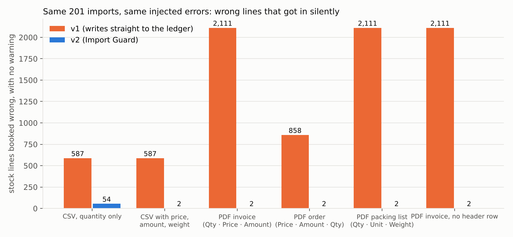
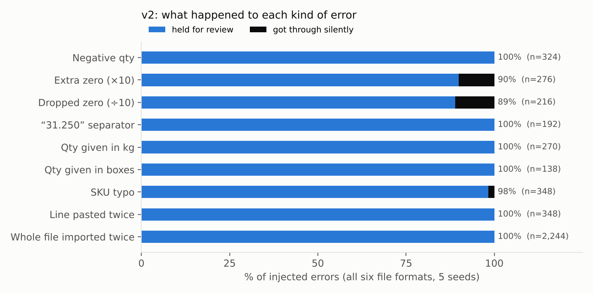
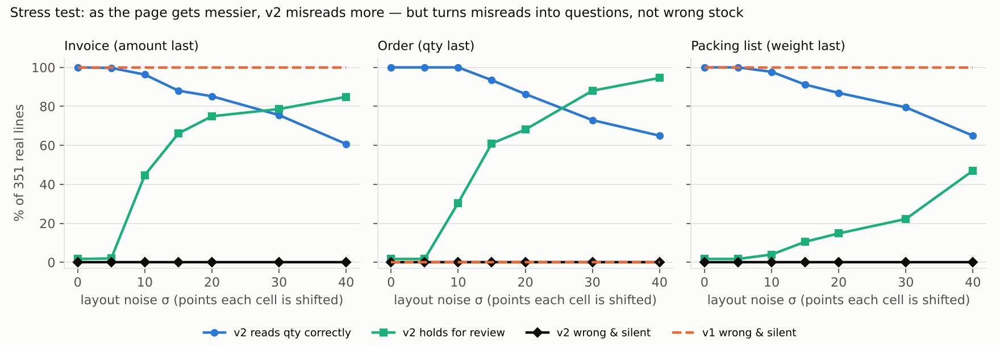

# Import Guard evaluation: v1 vs v2

Generated by `node eval/run.js && python3 eval/report.py` (2026-10-28). Every number below is reproducible: the corpus is deterministic.

## What was tested

- **Real data:** the 34 incoming documents (351 lines) from the company's *Inventory Stock List as on 1 July 2026* — real SKUs, real quantities (2 to 468,750 pcs), real suppliers — with real unit weights from the Zoho item master.
- **Synthetic:** unit prices (≈ USD 1.6–2.4/kg, fixed per SKU), the PDF page layouts, and the injected errors.
- **Formats:** each document rendered six ways — a quantity-only CSV, a CSV with price/amount/weight, three PDF layouts (amount last, quantity last, weight last) and a PDF with no header row.
- **Errors:** 20% of lines carry one injected error (negative, ×10, ÷10, “31.250”-style separator, kg instead of pcs, boxes instead of pcs, SKU typo, line pasted twice); 20% of documents use 1.234,5 number style; 15% of documents are imported twice. Five random seeds.
- **v1** = the original importer, unchanged (`eval/baseline_v1/imports_v1.js`). **v2** = this release.
- **The measure** is the business one: after the import, which stock lines are wrong, and did anything warn anyone? Scored per (document, SKU).

## Headline

Across all six formats, **v1 booked 8,365 wrong stock lines without any warning; v2 booked 64.** With a CSV that has price/amount/weight columns, or any of the three PDF layouts, v2 let through **2** silent errors out of 353 wrong lines.

| Format | v1 wrong & silent | v1 skipped with a message | **v2 wrong & silent** | v2 held for review | v2: clean documents committed with no human touch |
|---|---:|---:|---:|---:|---:|
| CSV, quantity only | 587 | 111 | **54** | 299 | 36/45 |
| CSV with price, amount, weight | 587 | 111 | **2** | 351 | 43/45 |
| PDF invoice (Qty · Price · Amount) | 2,111 | 0 | **2** | 351 | 43/45 |
| PDF order (Price · Amount · Qty) | 858 | 0 | **2** | 351 | 43/45 |
| PDF packing list (Qty · Unit · Weight) | 2,111 | 0 | **2** | 351 | 43/45 |
| PDF invoice, no header row | 2,111 | 0 | **2** | 360 | 43/45 |

*v1's “skipped with a message”: rows v1 refused (negative or unknown SKU) and listed after the import — the purchase order was still booked without them.*

## The cost: how often v2 bothers someone for nothing

Run on the 34 real documents with **no injected errors**:

| Format | real lines flagged | documents committed automatically | what was flagged |
|---|---:|---:|---|
| CSV, quantity only | 16/351 | 22/34 | MAGNITUDE_OUTLIER ×16 |
| CSV with price, amount, weight | 0/351 | 33/34 | — |
| PDF invoice (Qty · Price · Amount) | 0/351 | 33/34 | — |
| PDF order (Price · Amount · Qty) | 0/351 | 33/34 | — |
| PDF packing list (Qty · Unit · Weight) | 0/351 | 33/34 | — |
| PDF invoice, no header row | 2/351 | 31/34 | QTY_COLUMN_UNCERTAIN ×2 |

- With only a quantity column, the only evidence is history, so v2 asks about 16 real lines whose quantities are ≥10× off that SKU's usual order. Once price/amount/weight columns exist, those same quantities are confirmed by arithmetic and the questions disappear.
- The one real document held in every format is container **A563MHDG-C18**: 6 of its 7 lines are identical (SKU and quantity) to C17. v2 asks “is this the same order sent twice?”. It isn't — but it is exactly the question a person should be asked.
- With no header row, two lines are genuinely ambiguous (500 × 3 = 1,500: which is the quantity?) and v2 says so instead of guessing.

## Each kind of error

| Error | n | held (line) | held (whole document) | silent | v2's suggested fix was the true value |
|---|---:|---:|---:|---:|---:|
| Negative qty | 324 | 324 | 0 | 0 | 83% |
| Extra zero (×10) | 276 | 248 | 0 | 28 | 79% |
| Dropped zero (÷10) | 216 | 192 | 0 | 24 | 76% |
| “31.250” separator | 192 | 192 | 0 | 0 | 99% |
| Qty given in kg | 270 | 270 | 0 | 0 | 87% |
| Qty given in boxes | 138 | 138 | 0 | 0 | 68% |
| SKU typo | 348 | 342 | 0 | 6 | 68% |
| Line pasted twice | 348 | 348 | 0 | 0 | 0% |
| Whole file imported twice | 2,244 | 402 | 1,842 | 0 | 71% |

**Where v2 still fails:**
- **×10 / ÷10 typos in a quantity-only CSV:** 52 got through, all of them in that one format (about 63% of the ×10/÷10 errors it contained). With no price or weight to cross-check, the only evidence is order history — and some SKUs legitimately vary 10× between orders.
- **A typo that lands on another real SKU** with almost the same weight (BA325MT1GCM36X**140**F → …X**130**F, 1.55 vs 1.48 kg): nothing on the document contradicts it, in any format. This is the 1 silent case per format.

## Stress test: page-layout noise

For this test, every printed cell is shifted left or right at random by up to σ points, with no injected data errors. v1 ignores layout and always takes the last number, so it reads layout B correctly but gets every line wrong in layouts A and C. v2 reads fewer quantities correctly as the shifts grow, but **its silent-error count stays at 0**: when columns blur, the quantity no longer matches the printed amount or weight, and the line is held for review.

| Layout | σ | v2 read correctly | v2 held | v2 wrong & silent | v1 wrong & silent |
|---|---:|---:|---:|---:|---:|
| A | 0 | 351/351 | 6 | **0** | 351/351 |
| A | 5 | 350/351 | 7 | **0** | 351/351 |
| A | 10 | 338/351 | 157 | **0** | 351/351 |
| A | 15 | 309/351 | 232 | **0** | 351/351 |
| A | 20 | 299/351 | 263 | **0** | 351/351 |
| A | 30 | 265/351 | 276 | **0** | 351/351 |
| A | 40 | 213/351 | 298 | **0** | 351/351 |
| B | 0 | 351/351 | 6 | **0** | 0/351 |
| B | 5 | 351/351 | 6 | **0** | 0/351 |
| B | 10 | 351/351 | 107 | **0** | 0/351 |
| B | 15 | 328/351 | 214 | **0** | 0/351 |
| B | 20 | 303/351 | 239 | **0** | 0/351 |
| B | 30 | 256/351 | 309 | **0** | 0/351 |
| B | 40 | 228/351 | 332 | **0** | 0/351 |
| C | 0 | 351/351 | 6 | **0** | 351/351 |
| C | 5 | 351/351 | 6 | **0** | 351/351 |
| C | 10 | 343/351 | 14 | **0** | 351/351 |
| C | 15 | 320/351 | 37 | **0** | 351/351 |
| C | 20 | 305/351 | 52 | **0** | 351/351 |
| C | 30 | 279/351 | 78 | **0** | 351/351 |
| C | 40 | 228/351 | 165 | **0** | 351/351 |

Caveat: v2's zero depends on the document carrying a second number to check against (amount or weight). On a PDF with only a quantity column, layout noise could produce silent misreads; the arithmetic fallback would mark them low-confidence only when it finds no consistent reading.

## Changes made during evaluation (kept honest)
1. First PDF test, before any scoring: v2's column finder placed right-aligned numbers by distance to the header's centre, so “5,000” under “Qty” was read as the Unit column. Fixed by giving each column the span from its header's left edge to the next header's left edge.
2. First full run: v2's own number parser read “0.162” as 162 (it treated `0.` as a thousands group). That made clean prices look wrong. Fixed: a thousands group never starts with 0. All numbers above are after this fix.
3. Document totals were first only matched against the column they were printed under; noise showed totals rows are often offset. Now any printed total equal to a column sum counts. (This changed no headline number.)
No threshold was tuned on these results. Thresholds were set beforehand: 20% weight tolerance (galvanising + packaging), 10× from a SKU's own history (100× from its category's), 50 t per line (above the largest stock position on the separate 1 July stock list).
